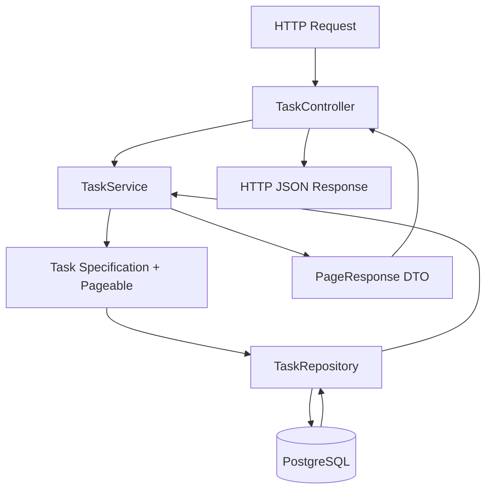

# Architecture — Advanced Task API

## Request lifecycle

## Responsibilities

- **Controller:** maps HTTP routes, reads query parameters, validates request bodies and selects HTTP response codes.
- **Service:** validates pagination/sort options, normalizes search input and builds a JPA Specification.
- **Repository:** executes the generated query and count query through Spring Data JPA.
- **Entity:** represents the persisted task record.
- **DTOs:** define request and response shapes; JPA entities are never returned directly.
- **GlobalExceptionHandler:** maps application, validation and parameter conversion errors to HTTP 400 or 404 Problem Details.

## GET /api/v1/tasks

Supported query parameters:

- `page`: zero-based page index, default 0.
- `size`: page size, default 10, maximum 100.
- `sortBy`: allow-listed fields `id`, `title`, `status`, `createdAt`.
- `direction`: `asc` or `desc`, default desc.
- `status`: optional task status.
- `search`: optional case-insensitive substring search on title.

The allowed sort-field list prevents arbitrary property names from being passed to Spring Data sorting.

## Filtering

A JPA Specification builds predicates only for filters that are present. Status and title search can be combined. Spring Data applies pagination and sorting at database level instead of loading every task and filtering it in memory.

## PATCH /api/v1/tasks/{id}/status

The endpoint accepts only a status DTO. It loads the task, updates its status and saves it; title and description remain unchanged.

## OpenAPI

springdoc generates the OpenAPI definition from Spring MVC mappings and exposes Swagger UI for interactive API exploration.

## Integration testing

`TaskApiIntegrationTest` starts a disposable PostgreSQL container with Testcontainers, injects its connection settings into Spring Boot, runs Flyway migrations, and exercises the HTTP API against the real database.

## Design boundaries

This milestone does not yet implement users, ownership, authentication or authorization. Those are intentionally introduced as a separate security milestone so that the API/data-access layer can be understood and tested independently.
